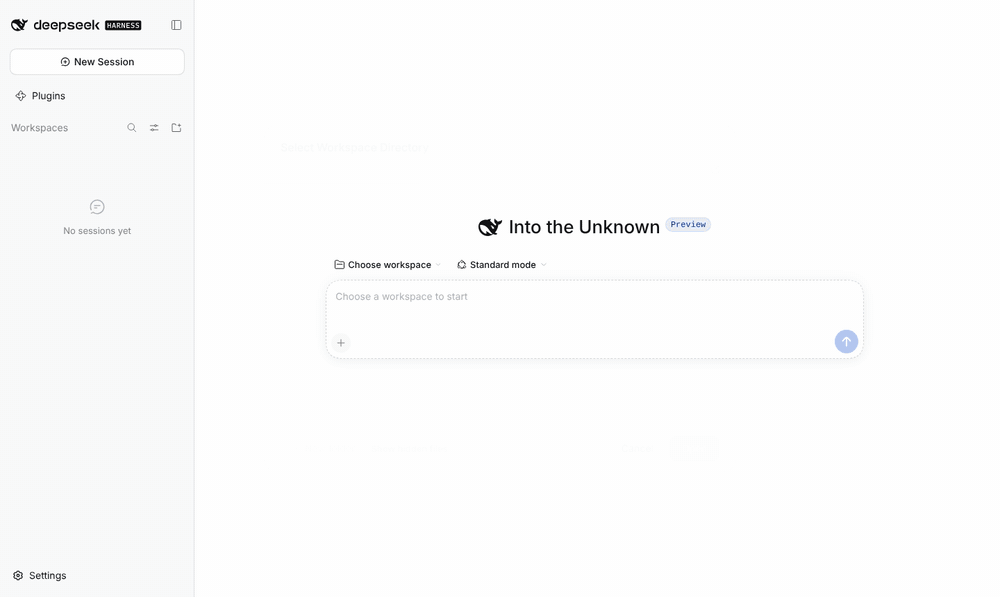
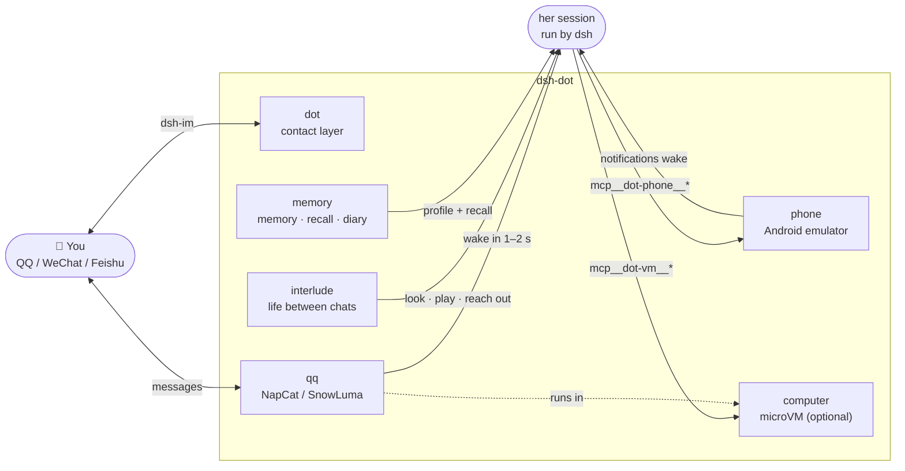

<div align="center">

# ◎ dsh-dot

**A character who lives on her own phone · a companion plugin for [DeepSeek Harness](https://github.com/deepseek-ai/deepseek-harness)**

She has her own Android phone, her own QQ, her own days and diary.<br>
Between your conversations, she keeps living.

[](https://www.npmjs.com/package/dsh-dot-life)
[](LICENSE)
[](https://github.com/deepseek-ai/deepseek-harness)
[](package.json)
[](https://github.com/Kevinwu901113/dsh-dot/stargazers)

[简体中文](README.md) · **English**

[Quick start](#-quick-start) · [Features](#-features) · [Settings](#%EF%B8%8F-settings) · [Architecture](#-architecture) · [Commands](#%EF%B8%8F-commands) · [Coexistence](#-coexisting-with-other-plugins)



</div>

---

## ✨ Features

- 📱 **A real phone** — the plugin downloads, builds and boots an Android emulator (no Java / Android Studio). No app store: **she installs her own apps**.
- 💬 **Her own QQ** — NapCat or SnowLuma (OneBot 11), same account as on her phone. Your message wakes her in **1–2 s**; she replies in several short messages and sends stickers.
- 🌙 **A life between conversations** — the interlude, ported from [HDS-Interlude](https://github.com/REcklessNOLOve117/HDS-Interlude): she writes down her days, keeps intents, goes to look at what she's curious about, and sometimes has a real reason to message you.
- 🧠 **Memory** — the words are the evidence, three short notes hold what stays true: every time she wakes, the past turns that bear on it (vector + BM25 candidates, reranked on your machine) come back to her by date; what she knows about you, about herself and what is not over yet is a small note; one card per person. Handoff at 150k tokens, a diary every night at 23:30.
- 🎮 **She browses and plays** — likes, comments and follows in the apps she installed herself. How much is her own habit, not a quota.
- 🖥️ **An optional computer** — a bundled microVM (no Docker): shell, browser, desktop, live view, approval gates, audit log.

> [!NOTE]
> **She can look, but never act behind your back.** Looking is read-only; anything with consequences (installing, passwords, payments, messaging strangers) goes through approval or isn't allowed at all.

## 🚀 Quick start

Requires dsh ≥ 0.2.1 and hardware virtualization (Apple silicon / Intel Mac, Linux with KVM, Windows with WHPX). Quit the dsh desktop app first:

```bash
# macOS
"/Applications/DeepSeek Harness.app/Contents/Resources/runtime/cli/bin/dsh" plugin --profile desktop add \
  dsh-dot-life @xmanrui/dsh-im
```

```powershell
# Windows
& "$env:LOCALAPPDATA\Programs\DeepSeek Harness\resources\runtime\cli\bin\dsh.cmd" plugin --profile desktop add `
  dsh-dot-life @xmanrui/dsh-im
```

Web: `dsh plugin --profile web add dsh-dot-life`. From source: use `github:Kevinwu901113/dsh-dot`.

Then, in dsh:

```text
/phone accept               # accept the Android SDK license; the phone installs itself (~2 GB)
/interlude preset 6QA0-1PD6 # import an HDSI persona from typ0.space
/qq install → /qq account <alt account> → /qq start → /qq qr
```

**Use alt accounts.** No platform's terms allow automation.

## ⚙️ Settings

Every personal setting lives in **one file**: `~/.dsh/dsh-dot.json` (Windows: `%USERPROFILE%\.dsh\dsh-dot.json`), one section per component. Upgrades never overwrite it; restart dsh after editing.

```json
{
  "phone":     { "dataGb": 32 },
  "computer":  { "rootDisk": "32G", "memory": "6G" },
  "interlude": { "activeHours": "09:00-01:00", "speak": true }
}
```

Every key, which ones only apply to a newly created phone / VM, and rules for agents editing the file: **[docs/SETTINGS.md](docs/SETTINGS.md)** (Chinese). Or just ask dsh: "follow docs/SETTINGS.md and set dsh-dot's phone storage to 32 GB".

## 🧩 Architecture

One plugin, six components. Each can be turned off on its own; the rest keep running.



| Component | What it is | Off switch |
|---|---|---|
| **`phone`** | Android emulator exposed as `mcp__dot-phone__*` via [mobile-mcp](https://github.com/mobile-next/mobile-mcp) · [docs](docs/phone.md) | `DSH_DOT_PHONE=off` |
| **`interlude`** | Canon persona, script, continuity, intents, read-only looking, optional proactive contact · [docs](docs/interlude.md) | `DSH_DOT_INTERLUDE=off` |
| **`qq`** | Her QQ inside the computer VM, same account as her phone · [docs](docs/qq.md) | `DSH_DOT_QQ=off` |
| **`memory`** | Transcript + auto-recall (local multilingual-e5-small + bge-reranker-base; SiliconFlow / DashScope optional), three notes (about you / herself / not over yet), people cards, diary, handoff · [docs](docs/memory.md) | `DSH_DOT_MEMORY=off` |
| **`dot`** | Scheduled results → IM, approval and device notices, working rules, sidebar status panel | `DSH_DOT_CONTACT=off` |
| **`computer`** | Bundled microVM ([microsandbox](https://github.com/zerocore-ai/microsandbox)) or Docker · [docs](docs/computer.md) | `DSH_DOT_COMPUTER=off` |

## ⌨️ Commands

```text
/phone [accept|restart|screenshot]
/interlude [now|advance|seed|preset <code>|canon]
/dot [test|check]
/dot memory [now|diary|handoff|recall …]
/dot people [approve <id>|drop <id>|forget <name>]
/qq [install|account|start|qr|backend|owner]
```

The **◎** button at the top of a conversation opens the dot panel: device status, handoff progress, what she's doing now, today's tokens, and her **last 30 scenes**.

## 🤝 Coexisting with other plugins

- With the computer on, dsh-dot replaces the subprocess provider, sets `sandbox-policy` to `danger-full-access` (the VM is the boundary) and rewrites permission presets — don't combine with other sandbox / subprocess / permission plugins, or set `DSH_DOT_COMPUTER=off`.
- MCP tools are namespaced: `mcp__dot-vm__*`, `mcp__dot-phone__*`.
- Memory coexistence (`DSH_DOT_MEMORY_COEXIST=auto`) drops to `people-only` when another memory service is found.
- One QQ account, one responder. `bash` also passes the computer gate.

See the [Chinese README](README.md#-与其他插件共存) for injected message `source` tags (for context-compression plugins) and upgrade notes.

## 📄 License

[AGPL-3.0-only](LICENSE). The interlude uses HDS-Interlude's (AGPL-3.0) prompts verbatim, so the whole package is AGPL. Computer / dot code released under MIT before v0.3 remains MIT in those versions.

<div align="center">

If she made you smile, leave a ⭐

</div>
