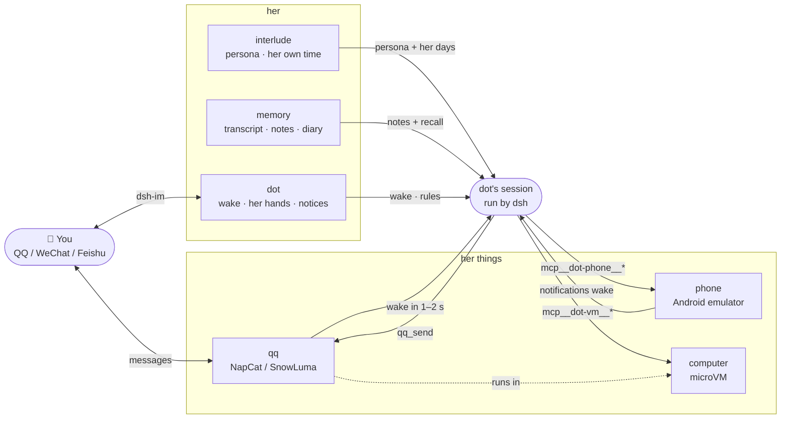

<div align="center">

# ◎ dsh-dot

**Turn your [DeepSeek Harness](https://github.com/deepseek-ai/deepseek-harness) into dot · a character with a persona, a memory and a life of her own**

Once installed, you are no longer talking to an agent. You are talking to her.<br>
She remembers you, keeps living between your conversations, and has her own phone and computer.

[](https://www.npmjs.com/package/dsh-dot-life)
[](LICENSE)
[](https://github.com/deepseek-ai/deepseek-harness)
[](package.json)
[](https://github.com/Kevinwu901113/dsh-dot/stargazers)

[](https://dsh.market/)
[](https://awesome-dsh-plugin.com)

[简体中文](README.md) · **English**

[Who she is](#-who-she-is) · [What she has](#-what-she-has) · [Quick start](#-quick-start) · [Settings](#%EF%B8%8F-settings) · [Architecture](#-architecture) · [Commands](#%EF%B8%8F-commands) · [Coexistence](#-coexisting-with-other-plugins)


</div>

---

## ✨ Who she is

dsh runs the conversation, calls the tools and carries the IM. dsh-dot decides **who is in that conversation**. In her sessions (the `~/dot` workspace and sessions opened by IM bots), dsh's own "You are an AI agent" opening is removed and replaced by her persona, her memory and the stretch of life she has just lived. In any other workspace dsh stays the dsh you know.

- 🎭 **A persona and a voice** — the Canon is the first section of the system prompt: import an HDSI preset from [typ0.space](https://typ0.space) by share code, or write `canon.json` yourself. Every prompt she receives is plain text; `/dot prompts` opens an editor page.
- 🧠 **Memory** — the words are the evidence, three short notes hold what stays true: every time she wakes, the past turns that bear on it (vector + BM25 candidates, reranked on your machine) come back to her by date; what she knows about you, about herself and what is not over yet is a small note; one card per person. Handoff at 150k tokens, a diary every night at 23:30.
- 🌙 **A life between conversations** — the interlude, an idea from [HDS-Interlude](https://github.com/REcklessNOLOve117/HDS-Interlude), implemented independently: she writes down her days, keeps intents and goes to look at what she is curious about. Reaching out to you is off by default and passes four gates when on.
- 🌱 **She grows** — two stretches of her own time a day, with no task, a token budget and a folder that is hers alone. She tries things she has not done, keeps her own notes on each app, and keeps a ledger of what she did, what it cost and what you said about it. Every Sunday she reviews the week and rewrites her self-portrait; every version is kept and can be rolled back.

## 🧰 What she has

- 📱 **A phone** — the plugin downloads, builds and boots an Android emulator (no Java / Android Studio, no window of its own; you watch it inside dsh). No app store: **she installs her own apps**. A notification from any app wakes her; she browses, likes, comments, follows and now and then posts.
- 🖥️ **A computer** — a bundled microVM (no Docker): shell, browser, desktop, live view, approval gates, audit log. Her commands run in the VM, not on your machine. It can be turned off.
- 💬 **A QQ account** — NapCat or SnowLuma (OneBot 11) inside her computer, same account as on her phone. Your message wakes her in **1–2 s**; she replies in several short messages and sends stickers.

The phone and the computer each have a power switch (`/phone off`, `/computer off`, or the top of the dot settings page); off stays off across dsh restarts.

> [!NOTE]
> **She can look, but never act behind your back.** Looking is read-only; anything with consequences (installing, payments, messaging strangers) goes through approval or isn't allowed at all. Every step she takes is logged.

## 🚀 Quick start

**Easiest: install from [DSH Market](https://dsh.market/).** With the market installed, open Settings → Plugin Market in dsh, search `dsh-dot` and click install:

```bash
dsh plugin --profile web add dshmarket
```

Without the market, use the command line below.

Requires dsh ≥ 0.2.1 and hardware virtualization (Apple silicon / Intel Mac, Linux with KVM, Windows with WHPX). Quit the dsh desktop app first:

```bash
# macOS
"/Applications/DeepSeek Harness.app/Contents/Resources/runtime/cli/bin/dsh" plugin --profile desktop add \
  dsh-dot-life @xmanrui/dsh-im
```

```powershell
# Windows
& "$env:LOCALAPPDATA\Programs\DeepSeek Harness\resources\runtime\cli\bin\dsh.cmd" plugin --profile desktop add `
  dsh-dot-life @xmanrui/dsh-im
```

Web: `dsh plugin --profile web add dsh-dot-life`. From source: use `github:Kevinwu901113/dsh-dot`.

Reopen dsh and click **"dot 设置" (dot settings)** in the left sidebar. It walks you through it: check this machine → pick components → phone → computer → persona → QQ. Settings, the doctor (with one-click fixes) and a diagnostics export live on the same page.

The same thing as commands:

```text
/interlude preset 6QA0-1PD6 # who she is: import an HDSI persona from typ0.space
/phone doctor               # check this machine: virtualization, disk, memory, ports, downloads, the phone network (one-click fixes: /phone doctor fix <id>)
/phone accept               # accept the Android SDK license; the phone installs itself (~2 GB)
/qq install → /qq account <alt account> → /qq start → /qq qr
```

**Use alt accounts.** No platform's terms allow automation.

> [!TIP]
> **No character, just a phone and a computer for dsh?** Turn off the dot / memory / interlude / qq components on the plugins page; the rest keeps running and the tools are still `mcp__dot-phone__*` / `mcp__dot-vm__*`.

## ⚙️ Settings

Every personal setting lives in **one file**: `~/.dsh/dsh-dot.json` (Windows: `%USERPROFILE%\.dsh\dsh-dot.json`), one section per component. Upgrades never overwrite it. The dot settings page edits this same file; after editing it by hand, restart dsh.

```json
{
  "phone":     { "dataGb": 32 },
  "computer":  { "rootDisk": "32G", "memory": "6G" },
  "interlude": { "activeHours": "09:00-01:00", "freeTimesPerDay": 2 }
}
```

Every key, which ones only apply to a newly created phone / VM, and rules for agents editing the file: **[docs/SETTINGS.md](docs/SETTINGS.md)** (Chinese). Or just ask dsh: "follow docs/SETTINGS.md and set dsh-dot's phone storage to 32 GB".

The model requests of her background life (memory consolidation, her hands operating the phone and computer) wait behind your ongoing conversation so they do not use up its requests-per-minute budget; if a chat still gets a 429, lower `llm.backgroundRpm`.

## 🧩 Architecture

One plugin, seven components: three are her, three are her things, one is for living next to other plugins. Each can be turned off on its own; the rest keep running.



| | Component | What it is | Off switch |
|---|---|---|---|
| her | **`interlude`** | Canon persona, the persona card and the checks on what she says, a voice reminder at the end of each turn; her own time; the ledger of what she did on her own · [docs](docs/interlude.md) | `DSH_DOT_INTERLUDE=off` |
| her | **`memory`** | Transcript + auto-recall (local multilingual-e5-small + bge-reranker-base; SiliconFlow / DashScope optional), three notes (about you / herself / not over yet), people cards, diary, handoff · [docs](docs/memory.md) | `DSH_DOT_MEMORY=off` |
| her | **`dot`** | The contact layer: notifications and schedules wake her, her hands (a separate session that operates the phone and computer a step at a time), scheduled results → IM, approval and device notices, working rules, her per-app notes, sidebar status panel | `DSH_DOT_CONTACT=off` |
| her things | **`phone`** | Android emulator exposed as `mcp__dot-phone__*` via [mobile-mcp](https://github.com/mobile-next/mobile-mcp) · [docs](docs/phone.md) | `DSH_DOT_PHONE=off` |
| her things | **`computer`** | Bundled microVM ([microsandbox](https://github.com/zerocore-ai/microsandbox)) or Docker, exposed as `mcp__dot-vm__*` · [docs](docs/computer.md) | `DSH_DOT_COMPUTER=off` |
| her things | **`qq`** | Her QQ inside the computer VM, same account as her phone · [docs](docs/qq.md) | `DSH_DOT_QQ=off` |
| neighbours | **`compat`** | Living next to other plugins: whose session is this, which tools it sees, where its commands run; knows [qq-bridge](https://github.com/Derpyu520/qq-bridge) today · [docs (zh)](docs/qq-bridge.md) | `DSH_DOT_COMPAT=off` |

## ⌨️ Commands

```text
/dot [doctor|test|check|prompts [stop]|howto [app]]
/dot memory [now|diary|handoff|recall …]
/dot people [approve <id>|merge <a> <b>|forget <name>]
/interlude [preset <code>|canon|doings|feedback [#id] <text>|free]
/phone [on|off|doctor [fix <id>]|accept [GB]|size <GB>|number <digits>|restart|retry|screenshot|notifications|notify [mute|wake <pkg>]]
/computer [on|off]
/qq [install [snowluma]|backend|account|owner|start|stop|qr|log|clean [napcat]|stickers [sync]|group <mention|all|none|score>]
```

Two pages: "dot 设置" in the left sidebar is for setup, settings, the doctor and diagnostics; the **◎** button at the top of a conversation opens the dot panel in the right sidebar, which is her life: device status, handoff progress, what she's doing now, today's tokens, and her **last 30 scenes**.

## 🤝 Coexisting with other plugins

- With the computer on, dsh-dot replaces the subprocess provider, sets `sandbox-policy` to `danger-full-access` (the VM is the boundary) and rewrites permission presets — don't combine with other sandbox / subprocess / permission plugins, or set `DSH_DOT_COMPUTER=off`.
- MCP tools are namespaced: `mcp__dot-vm__*`, `mcp__dot-phone__*`.
- Memory coexistence (`DSH_DOT_MEMORY_COEXIST=auto`) drops to `people-only` when another memory service is found.
- One QQ account, one responder. `bash` also passes the computer gate.
- [qq-bridge](https://github.com/Derpyu520/qq-bridge) is detected and lived with (`compat` settings, [docs/qq-bridge.md](docs/qq-bridge.md)): none of dot's tools in its sessions, its folder never shared into her VM, its bot never answered; its closed-agent owner chat gets her phone and computer.

See the [Chinese README](README.md#-与其他插件共存) for injected message `source` tags (for context-compression plugins) and upgrade notes.

## 📄 License

[MIT](LICENSE). Versions 0.3 through 0.22 were released under AGPL-3.0-only (the interlude then used a translation of HDS-Interlude's prompts) and stay AGPL; from 0.23 on the interlude prompts are rewritten from scratch, nothing of HDS-Interlude's code or text is included, and the whole package is MIT.

<div align="center">

If she made you smile, leave a ⭐

</div>
