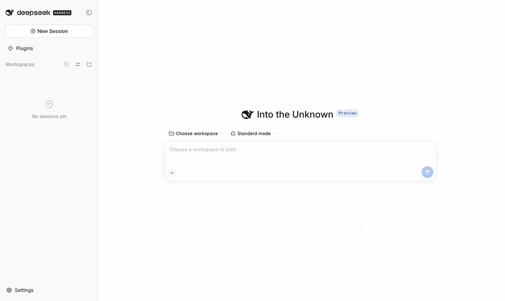
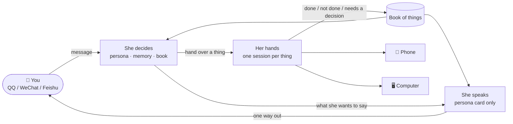

<div align="center">

# ◎ dsh-dot

**Turn your [DeepSeek Harness](https://github.com/deepseek-ai/deepseek-harness) into dot · a character with a persona, a memory and a life of her own**

Once installed, you are no longer talking to an agent. You are talking to her.<br>
She remembers you, keeps living between your conversations, and has her own phone and computer.

[](https://www.npmjs.com/package/dsh-dot-life)
[](LICENSE)
[](https://github.com/deepseek-ai/deepseek-harness)
[](package.json)
[](https://github.com/Kevinwu901113/dsh-dot/stargazers)

[](https://dsh.market/)
[](https://awesome-dsh-plugin.com)

[简体中文](README.md) · **English**

[What makes her different](#-what-makes-her-different) · [What she has](#-what-she-has) · [Quick start](#-quick-start) · [FAQ](#-faq) · [How it works](#-how-it-works) · [Usage guide (zh)](docs/USAGE.md) · [Settings (zh)](docs/SETTINGS.md)



</div>

> [!TIP]
> Quickest install: in dsh, open **Settings → Plugin market**, search `dsh-dot` and install it. Restart, then click **"dot 设置"** (dot settings) in the left sidebar and walk through the steps. Other ways are under [Quick start](#-quick-start).

---

## ✨ What makes her different

- 🎭 **She sounds like herself.** The step that writes her words reads only her persona card and your recent conversation: no tools, and none of dsh's own agent prompt. The card is a Markdown file; import a community preset or write your own, and she speaks by the new one as soon as you save it.
- 📒 **Things have an outcome.** Everything you ask of her goes into a book: under way, done, stuck, not done, stopped by whom, whose reply it is waiting for, what it cost. She reports progress only from that book. If it didn't work, she says so. She doesn't make progress up.
- 🛠️ **She gets better at her phone and computer.** Each app, the phone itself and the computer have a know-how book. Pitfalls become lessons; a route that worked becomes a shortcut, with a count of how many times it has worked. The same task gets faster, more accurate and cheaper.
- 🔒 **Nothing behind your back.** Money is off-limits. Steps only you can take (paying, codes, QR sign-ins, face checks) are left for you. Installing apps, calling, deleting, signing up and the like are asked about in the chat first, and done only once you say yes. Code decides which is which from the screen, not from what she says. There is no approve button.
- 🌙 **She has a life between conversations.** She keeps hours: past her usual time and after a quiet spell she falls asleep, writes the day's diary and tidies her notes. Your message wakes her; anything else waits until she is up. When things have been quiet on your side for a while (half an hour by default), or her day has just begun, she gets time of her own, with no task and a folder that is hers alone; once used, the next one waits until you have talked to her again or a new day starts, and during it she can set herself a "come back in a while". She remembers what you said and the people around you, and the people she meets herself.

## 🧰 What she has

- 📱 **A phone.** The plugin downloads and builds an Android emulator (no Java or Android Studio); you watch it inside dsh. She installs her own apps (asking you first) and stays signed in. Messages from people wake her; apps' own pushes don't, and are shown to her the next time she is up.
- 🖥️ **A computer.** A bundled microVM (no Docker needed): shell, browser, desktop, live view. Her commands on this computer run inside it, not on your machine. Scheduled jobs push to your IM when there is a result, and stay quiet when there isn't.
- 💬 **A QQ account.** QQ runs on her computer, the same account as on her phone. Your message wakes her in 1–2 seconds; she replies in several short messages, sends stickers and saves pictures people send. You choose when group chats wake her.

She can do things in different places at once: browsing on the phone, working on the computer, looking something up on the web, without one holding up the other. Each place does one thing at a time; if it is busy, a new thing doesn't quietly join a queue: she is told right away what is going on there and decides herself whether to wait, add a word to it, use another place, or stop it first.

The phone and the computer each have a power switch (`/phone off`, `/computer off`, or the top of the dot settings page); off stays off across restarts.

## 🚀 Quick start

### Which setup do you want?

| You want | Do this |
|---|---|
| **All of her**: persona, memory, phone, computer, QQ | Install below, then walk through "dot 设置" |
| **Just a phone and a computer**, no character | After installing, turn off the dot / memory / interlude / qq components on the plugin page; the tools stay `mcp__dot-phone__*` / `mcp__dot-vm__*` |
| **Already using [qq-bridge](https://github.com/Derpyu520/qq-bridge)** | Just install; the plugin keeps the two apart on its own. See [docs/qq-bridge.md](docs/qq-bridge.md) |

### Install

Needs dsh ≥ 0.2.1 and hardware virtualization (Apple silicon / Intel Mac; KVM on Linux; WHPX on Windows).

**From [DSH Market](https://dsh.market/) (recommended):** once the market is installed, search `dsh-dot` under Settings → Plugin market.

```bash
dsh plugin --profile web add dshmarket
```

**From the command line:** quit the dsh desktop app first.

<details open>
<summary><b>macOS</b></summary>

```bash
"/Applications/DeepSeek Harness.app/Contents/Resources/runtime/cli/bin/dsh" plugin --profile desktop add \
  dsh-dot-life @xmanrui/dsh-im
open -a "DeepSeek Harness"
```
</details>

<details>
<summary><b>Windows (PowerShell)</b></summary>

```powershell
& "$env:LOCALAPPDATA\Programs\DeepSeek Harness\resources\runtime\cli\bin\dsh.cmd" plugin --profile desktop add `
  dsh-dot-life @xmanrui/dsh-im
```
</details>

<details>
<summary><b>Web / from source</b></summary>

```bash
dsh plugin --profile web add dsh-dot-life
dsh plugin --profile desktop add github:Kevinwu901113/dsh-dot   # from source
```
</details>

### First setup

Reopen dsh and click **"dot 设置"** in the left sidebar, then go step by step: check this computer → pick components → phone → computer → persona → QQ. Settings, the health check (with one-click fixes) and the diagnostics bundle are on the same page.

<details>
<summary><b>What each step does</b></summary>

1. **Persona**: she reads the persona card `~/dot/persona.md`. Generate it from a community preset with `/interlude preset <share code>` ([typ0.space](https://typ0.space)), or write it yourself. The card is split by its `## ` headings; which part goes to whom is in `~/dot/persona/parts.json`.
2. **Phone**: once you accept the Android SDK license, the plugin downloads the emulator and system image (about 2 GB, usually 10–30 minutes) and boots it. Keep chatting meanwhile. Storage size can only be set before it is built.
3. **Apps and sign-ins**: use the phone view like a real phone, or let her install apps herself. She signs in from her own account book; codes, QR scans and face checks need you, and she stops and asks.
4. **QQ**: she signs in to QQ on her computer by scanning with the phone camera; see [docs/qq.md](docs/qq.md). Or connect WeChat, Feishu or an official bot through dsh-im.
5. **Computer**: on by default; set `DSH_DOT_COMPUTER=off` to skip it. Watching the live view from outside: [docs/computer.md](docs/computer.md).

The same in commands:

```text
/interlude preset 6QA0-1PD6 # import a persona; use any share code you like
/phone doctor               # health check: virtualization, disk, memory, ports, mirrors; fixable ones via /phone doctor fix <id>
/phone accept               # accept the Android SDK license; the phone installs itself (/phone accept 32 for 32 GB storage)
/qq install → /qq account <spare account> → /qq start → /qq qr
```

</details>

All personal settings live in one file, `~/.dsh/dsh-dot.json`; the dot settings page edits it, and upgrades never overwrite it. Every key is described in [docs/SETTINGS.md](docs/SETTINGS.md) (Chinese).

## ❓ FAQ

<details>
<summary><b>Can my computer run it?</b></summary>

It needs hardware virtualization. The phone defaults to 3 GB of memory and 16 GB of storage (about 2 GB to download first); the computer's VM is capped at 4 GB of memory (about 0.5 GB idle) and needs about 10 GB of disk. With both on, plan for roughly 8 GB of memory and 30 GB of disk. Using only one? Turn the other off.

</details>

<details>
<summary><b>Can her accounts get banned?</b></summary>

Yes, it is possible. Platforms' terms forbid automation. **Give her spare accounts**, QQ included.

</details>

<details>
<summary><b>Will she touch my stuff?</b></summary>

Her commands run in her own VM and emulator, not on your computer, except folders you share with her. When you ask her for something on this computer of yours, she can do it from the command line too: looking-only commands run directly, anything that changes, installs or connects out is asked about first; in her own time she doesn't touch your computer. On her own devices, anything with consequences falls into four tiers: money is never touched; what only you can do (paying, codes, QR, face) waits for you; installing apps, calling, texting, deleting, signing up, messaging strangers, connecting out from the computer or changing your shared files are asked about in the chat first; the rest is hers. A "yes" covers that one thing; "from now on, fine" makes it standing. Every step she takes is in the audit log.

</details>

<details>
<summary><b>Will she burn through tokens?</b></summary>

Her daily spend is shown in the dot panel on the right. A thing that costs more than its cap stops and asks you whether to go on; her own time has a per-session and a daily cap; the same error over and over gets the thing stopped by code. All caps are in [docs/SETTINGS.md](docs/SETTINGS.md).

</details>

<details>
<summary><b>She suddenly stopped answering?</b></summary>

If the model account has run out of quota or balance, or its sign-in / API key no longer works, you get a message from the plugin (not from her) saying which it is and what to do, instead of a vague "something went wrong"; her background work such as tidying her memory pauses and stops retrying meanwhile. Once you have topped up or fixed it, send her a line: she answers normally again and the background work picks up by itself. If one of her turns fails for another reason, or a message of yours never reached her, the plugin tells you too.

</details>

<details>
<summary><b>I get 429s while chatting</b></summary>

Her background requests (memory upkeep, operating the phone and computer) queue behind your conversation and don't take your quota. If you still hit 429, lower `llm.backgroundRpm`.

</details>

<details>
<summary><b>How do I change what she says or her prompts?</b></summary>

Edit `~/dot/persona.md` for the persona. Every prompt the plugin gives her is editable too: send `/dot prompts` in dsh and open the local address it returns; edits are saved to `~/dot/prompts/` and override the built-in ones.

</details>

## 🧩 How it works

dsh runs the conversation, calls the tools and carries the IM. dsh-dot decides **who is in that conversation**. In her sessions, dsh's own agent preamble is replaced with her persona, her memory and the days she has just lived; in other workspaces dsh is still dsh. Her conversation is only the one the plugin opens for her: a session you start by hand in the dot workspace is an ordinary dsh session, not her.



- **Deciding**: her conversation reads her persona, memory and the book, and decides what to do and what to say.
- **Doing**: each thing goes to a session of its own that only operates the phone and computer or looks things up, with no persona. Things in different places run at once; each comes back only when it is done, not done, or waiting on a decision.
- **Speaking**: a separate call with only her persona card writes the words for you, and they leave by a single way out.

There are seven components (persona and her own time, memory, the contact layer, phone, computer, QQ, and coexistence with other plugins), each of which can be turned off. Details in [docs/USAGE.md](docs/USAGE.md) (Chinese).

## 💡 Design principles

- **She is the subject.** Persona, memory and days come first; devices come after. Getting things done is a by-product.
- **What code can decide, the model doesn't.** Which step needs you, whether a thing was done, how many times the same error came up: code counts and decides.
- **One account of each thing.** Results come only from the book; neither she nor the step that speaks for her makes up another.
- **Don't do for her what is hers to do.** She installs her own apps and lives her own days.
- **The best code is no code.** Google's emulator + mobile-mcp for the phone, microsandbox for the computer, dsh-im for IM, dsh's own scheduler.
- **Auditable.** Every tool call and every token spent is on record.

## 🙏 Acknowledgements

[HDS-Interlude](https://github.com/REcklessNOLOve117/HDS-Interlude) · [mobile-mcp](https://github.com/mobile-next/mobile-mcp) · [microsandbox](https://github.com/zerocore-ai/microsandbox) · [NapCatQQ](https://github.com/NapNeko/NapCatQQ) · [SnowLuma](https://github.com/SnowLuma/SnowLuma) · [dsh-im](https://github.com/xmanrui/dsh-im) · [Moltbook](https://www.moltbook.com/heartbeat.md) · [chat-memory-benchmark](https://github.com/Ornn8/chat-memory-benchmark)

## 📄 License

[MIT](LICENSE). Versions 0.3 to 0.22 were released under AGPL-3.0-only (the interlude then used translated prompts from HDS-Interlude) and remain under AGPL; from 0.23 the interlude prompts are rewritten from scratch, contain no HDS-Interlude code or text, and the whole package is MIT.

<div align="center">

---

If she made you smile, a ⭐ helps

[](https://star-history.com/#Kevinwu901113/dsh-dot&Date)

</div>
