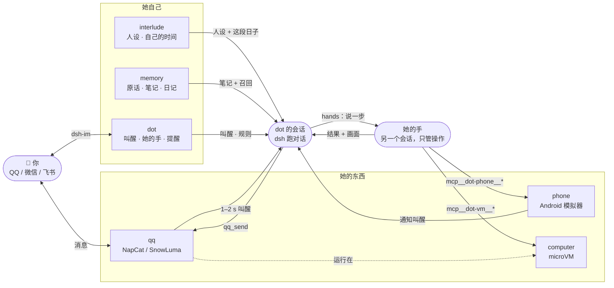

<div align="center">

# ◎ dsh-dot

**让你的 [DeepSeek Harness](https://github.com/deepseek-ai/deepseek-harness) 成为 dot · 一个有人设、有记忆、自己过日子的角色**

装上之后，和你说话的不再是一个 agent，是她。<br>
她记得你，你们不聊天的时候也在过日子，还有自己的手机和电脑。

[](https://www.npmjs.com/package/dsh-dot-life)
[](LICENSE)
[](https://github.com/deepseek-ai/deepseek-harness)
[](package.json)
[](https://github.com/Kevinwu901113/dsh-dot/stargazers)

[](https://dsh.market/)
[](https://awesome-dsh-plugin.com)

**简体中文** · [English](README.en.md)

[她是谁](#-她是谁) · [她有什么](#-她有什么) · [快速开始](#-快速开始) · [设置](#%EF%B8%8F-设置) · [架构](#-架构) · [命令](#%EF%B8%8F-命令与文件) · [共存](#-与其他插件共存) · [路线图](docs/ROADMAP.md)


</div>

---

## ✨ 她是谁

dsh 负责跑对话、调工具、接 IM；dsh-dot 决定**这段对话里的人是谁**。在她的会话里（`~/dot` 工作区和 IM 机器人开的会话），dsh 自带的「You are an AI agent」开场白被拿掉，换成她的人设、她的记忆和她刚过完的这段日子。别的工作区里，dsh 还是原来的 dsh。

<table>
<tr>
<td width="50%" valign="top">

### 🎭 有自己的人设和说话方式
人设（Canon）是系统提示的第一段：用分享码从 [typ0.space](https://typ0.space) 导入一份 HDSI 预设，或者自己写 `canon.json`。口癖、长度、标点跟着人设走，每轮最后再提醒她一次怎么说话。她收到的每段话都是纯文本，`/dot prompts` 打开网页就能改。

</td>
<td width="50%" valign="top">

### 🧠 记得你，也记得她遇到的人
原话负责证据，笔记负责长期状态：每次被叫醒，相关的旧原话（向量 + BM25）按日期翻到她面前，另有几条「事实条」——以后用得上的事各写成一句话，对得上眼前的话时给她看；关于你、她自己、还没了的事（有日子的到那天会提）记在一份小笔记里；每个人一张卡。15 万 token 交班，每天 23:30 写日记、整理一次笔记。

</td>
</tr>
<tr>
<td valign="top">

### 🌙 两次对话之间也在生活
她的日子只由真做过的事组成，没有人替她编：手机响了她去看，隔一阵自己拿起手机，每天有两段自己的时间。在手机和电脑上逛、登录、发东西，都是她在对话里一步步交给「手」去做，看了结果和画面再定下一步。什么时候主动找你由她定，她眼前只有事实：今天找过几次、你回了几次。

</td>
<td valign="top">

### 🌱 会自己长
每天两段「自己的时间」，不给任务，有 token 预算，还有一个只属于她的文件夹。每个 App 用熟了自己记笔记；逛的时候看到好玩的说法可以原样记下，以后话题对上了会想起来；做过什么、花了多少、你怎么说，都记在她自己的账上。人设卡是固定的，变的是她记下的东西。

</td>
</tr>
</table>

## 🧰 她有什么

<table>
<tr>
<td width="33%" valign="top">

### 📱 一部手机
插件自己下载、建好、开机一台 Android 模拟器，不需要 Java / Android Studio，也不弹窗口，画面在 dsh 里看。App 和登录态都在里面，重启不丢。没有应用商店，**App 她自己装**。任何 App 的通知都能叫醒她；她在上面逛、点赞、评论、关注、偶尔发帖。

</td>
<td width="33%" valign="top">

### 🖥️ 一台电脑
自带的 microVM（不需要 Docker）：shell、浏览器、桌面、实时画面、审批闸门、审计日志。她的命令在虚拟机里跑，不在你的机器上跑。定时任务有结果推到 IM，没有就安静。不要可以关。

</td>
<td width="33%" valign="top">

### 💬 一个 QQ 号
NapCat / SnowLuma（OneBot 11）跑在她的电脑里，和手机上是同一个号。你发消息 **1–2 秒叫醒她**，她分条回、会发表情包、会存别人发的图。群消息什么时候叫醒她可以选。

</td>
</tr>
</table>

手机和电脑各有一个电源开关（`/phone off`、`/computer off`，或 dot 设置页顶部），关了重启 dsh 也保持关着。

> [!NOTE]
> **她只能看，不能瞒着你动。** 「去看」是只读的；装 App、花钱、给陌生人发消息这类有后果的动作，要么走审批，要么根本不给。她做过的每一步都有记录。

## 🚀 快速开始

**最省事：从 [DSH Market](https://dsh.market/) 装。** 装好插件市场后，在 dsh 的「设置 → 插件市场」里搜 `dsh-dot`，点一下安装：

```bash
dsh plugin --profile web add dshmarket
```

不用插件市场就走下面的命令行。

需要 dsh ≥ 0.2.1，以及硬件虚拟化（Apple silicon / Intel Mac；Linux 需 KVM；Windows 需 WHPX）。先退出 dsh 桌面版：

<details open>
<summary><b>macOS</b></summary>

```bash
"/Applications/DeepSeek Harness.app/Contents/Resources/runtime/cli/bin/dsh" plugin --profile desktop add \
  dsh-dot-life @xmanrui/dsh-im
open -a "DeepSeek Harness"
```
</details>

<details>
<summary><b>Windows（PowerShell）</b></summary>

```powershell
& "$env:LOCALAPPDATA\Programs\DeepSeek Harness\resources\runtime\cli\bin\dsh.cmd" plugin --profile desktop add `
  dsh-dot-life @xmanrui/dsh-im
```
</details>

<details>
<summary><b>Web 版 / 从源码</b></summary>

```bash
dsh plugin --profile web add dsh-dot-life
dsh plugin --profile desktop add github:Kevinwu901113/dsh-dot   # 源码
```
</details>

重新打开 dsh，点左侧栏的 **「dot 设置」**，照着一步步点完：检查这台电脑 → 选组件 → 手机 → 电脑 → 人设 → QQ。设置、体检（能修的一键修）、导出诊断包也都在这一页。

喜欢敲命令的话，等价的是：

```text
/interlude preset 6QA0-1PD6 # 她是谁：从 typ0.space 导入一份 HDSI 人设，换成你喜欢的分享码
/phone doctor               # 体检这台电脑：虚拟化、磁盘、内存、端口、下载源、手机网络；能一键修的给 /phone doctor fix <id>
/phone accept               # 接受 Android SDK 许可，手机开始自己装（约 2 GB；/phone accept 32 给 32 GB 存储）
/qq install → /qq account <小号> → /qq start → /qq qr   # 她用手机摄像头扫码登录电脑 QQ
```

<details>
<summary><b>第一次设置的完整说明</b></summary>

1. **人设**：`/interlude preset <分享码>`，或把 [`examples/canon.example.json`](examples/canon.example.json) 放到 `~/dot/interlude/canon.json`。`/interlude canon` 看当前人设，`/interlude seed` 给空剧本写一个开场。
2. **手机**：`/phone accept` 后插件下载模拟器、platform-tools、系统镜像（约 2 GB，常见 10–30 分钟；进度在 `/phone` 和 dot 设置页里），装完自动开机；手机不弹自己的窗口，画面在 dsh 里看（dot 设置页顶部的「看画面」，或右侧栏的手机标签），她会自己跟你说一声。装的过程中照常聊天，她不会等。存储大小建好后不能再改（`/phone size <GB>` 要在建之前设）。
3. **装 App、登录**：在手机画面里像真手机一样操作，或者让她自己装（`mobile_install_app` 会弹审批）。登录、验证码、人脸由你亲手过，她遇到会停下来叫你。**用小号**，各平台条款都不允许自动化。
4. **她逛什么**：不用配。常见社区 App 的站点 → 包名表是内置的，只对她**自己装了**的 App 生效。其他 App 在设置里给 `interlude` 加 `phoneApps` / `playApps`。
5. **QQ**：详见 [docs/qq.md](docs/qq.md)。不想用协议端，也可以按 dsh-im 的说明接官方机器人。
6. **电脑**：默认装上并启动；不要就设 `DSH_DOT_COMPUTER=off`。公网看实时画面见 [docs/computer.md](docs/computer.md)。

</details>

> [!TIP]
> **不要角色，只想给 dsh 一部手机和一台电脑？** 在插件页把 dot / memory / interlude / qq 四个组件关掉，剩下的照常跑，工具还是 `mcp__dot-phone__*` / `mcp__dot-vm__*`。<br>
> **已经在用 [qq-bridge](https://github.com/Derpyu520/qq-bridge)？** 直接装，什么都不用配：插件会认出 qq-bridge，它的会话里不出现 dot 的工具，它的目录不进虚拟机，它的机器人号她不回；把 qq-bridge 切到 closed-agent 模式，管理员私聊就能用她的手机和电脑。细节在 [docs/qq-bridge.md](docs/qq-bridge.md)。

## ⚙️ 设置

所有个人设置都在**一个文件**：`~/.dsh/dsh-dot.json`（Windows：`%USERPROFILE%\.dsh\dsh-dot.json`），按组件分段，升级插件不会覆盖。左侧栏的「dot 设置」页改的就是这个文件，每一项都标了什么时候生效；手改的话改完重启 dsh。

```json
{
  "phone":     { "dataGb": 32 },
  "computer":  { "rootDisk": "32G", "memory": "6G" },
  "dot": { "awakeHours": "09:00-01:00" },
  "interlude": { "freeTimesPerDay": 2 }
}
```

存储、作息、主动联系、群聊规则、省 token、网络镜像、后台请求限速……每一项怎么改、哪些只在新建手机 / 虚拟机时生效，都在 **[docs/SETTINGS.md](docs/SETTINGS.md)**。

她在后台（整理记忆、她的手在操作手机和电脑）发出的模型请求，都排在你正在进行的对话后面，不抢你的每分钟请求额度；聊天时还是报 429，就调 `llm.backgroundRpm`。

> [!TIP]
> 懒得自己改？直接对 dsh 说「按 docs/SETTINGS.md 把 dsh-dot 的手机存储改成 32 GB」。文档里有写给 agent 的规则，dsh 或其他 agent 照着就能改对。

## 🧩 架构

一个插件，七个组件：三个是她自己，三个是她的东西，一个管和别的插件共处。每个都能单独关，缺了哪个其余照常跑。



**她自己**

| 组件 | 是什么 | 依赖 | 关掉 |
|---|---|---|---|
| **`interlude`** 🌙 | 人设（Canon）、人设卡和说话检查表、每轮最后的说话提醒；自己的时间；她自己做过的事的账 · [文档](docs/interlude.md) | — | `DSH_DOT_INTERLUDE=off` |
| **`memory`** 🧠 | 原话库 + 自动召回（本机 multilingual-e5-small，可切 SiliconFlow / DashScope）；三栏笔记（关于你 / 她自己 / 还没了的事）；人物卡；日记；15 万 token 交班 · [文档](docs/memory.md) | — | `DSH_DOT_MEMORY=off` |
| **`dot`** ◎ | 联系人层：通知和定时把她叫醒、她的手（操作手机和电脑的另一个会话）、定时结果 → IM、审批与设备提醒、工作规则、她在每个 App 里攒的用法笔记、右侧栏状态面板 | [dsh-im](https://github.com/xmanrui/dsh-im) | `DSH_DOT_CONTACT=off` |

**她的东西**

| 组件 | 是什么 | 依赖 | 关掉 |
|---|---|---|---|
| **`phone`** 📱 | Android 模拟器，以 `mcp__dot-phone__*` 暴露（[mobile-mcp](https://github.com/mobile-next/mobile-mcp) 走 adb）；任何 App 的通知都能叫醒她，可以按 App 静音 · [文档](docs/phone.md) | 硬件虚拟化 | `DSH_DOT_PHONE=off` |
| **`computer`** 🖥️ | 自带 microVM，以 `mcp__dot-vm__*` 暴露：shell、浏览器、桌面、实时画面、审批、审计 · [文档](docs/computer.md) | [microsandbox](https://github.com/zerocore-ai/microsandbox)（自带）或 Docker | `DSH_DOT_COMPUTER=off` |
| **`qq`** 💬 | 她电脑 VM 里的 QQ，和手机同号；`qq_send` 回复、表情包 · [文档](docs/qq.md) | computer | `DSH_DOT_QQ=off` |

**共处**

| 组件 | 是什么 | 依赖 | 关掉 |
|---|---|---|---|
| **`compat`** 🤝 | 和别的插件共处：每个会话归谁、看得见哪些工具、命令在哪跑；今天认 [qq-bridge](https://github.com/Derpyu520/qq-bridge) · [文档](docs/qq-bridge.md) | — | `DSH_DOT_COMPAT=off` |

## 🕰️ 她的一天

| 时刻 | 发生什么 |
|---|---|
| **你找她** | QQ 消息 1–2 秒叫醒她的对话；她忙时来的消息攒到那轮结束一起处理，回复按行拆成多条 |
| **手机响了** | 任何 App 的新通知叫醒她：`[11-04 04:52 手机通知] QQ · 宽：在吗`。她自己去回，或者不理 |
| **拿起手机** | 没响也会隔一阵（默认 30 分钟）看一眼，有没回的就回，没事就放下 |
| **用手机和电脑** | 还是她自己，在对话里把一步步交给「手」去做；手做完，结果和当时的画面回到对话，她看了再定下一步。自己的时间里做了什么、花了多少记进她的账 |
| **自己的时间** | 每天两次（默认），活跃时段里随机挑时刻，你们正在聊天时不开；只告诉她「这段时间是你自己的」 |
| **想找你** | 没有次数上限：她眼前有今天主动了几次、你回了几次、上一条回没回，找不找由她定 |
| **23:30** | 写今天的日记，把今天里值得一直记着的记进笔记 |

## ⌨️ 命令与文件

```text
/dot [doctor|test|check|prompts [stop]|howto [app]]
/dot memory [now|diary|handoff|recall …]
/dot people [approve <id>|merge <a> <b>|forget <名字>]
/interlude [preset <code>|canon|doings|feedback [#id] <一句话>|free]
/phone [on|off|doctor [fix <id>]|accept [GB]|size <GB>|number <号码>|restart|retry|screenshot|notifications|notify [mute|wake <包名>]]
/computer [on|off]
/qq [install [snowluma]|backend|account|owner|start|stop|qr|log|clean [napcat]|stickers [sync]|group <mention|all|none|score>]
```

**两个页面**：左侧栏的「dot 设置」是装、设、查、导（初始化步骤、设置表单、体检、诊断包）；会话顶部 ◎ 按钮打开的右侧栏 dot 标签页是她的生活——设备状态、交班进度、她此刻在做什么、今天的 token，以及**最近 30 场**（每次被叫醒到结束是一场，展开看她做了什么、说了什么）。

**改提示词和人设**：在 dsh 里发 `/dot prompts`，回一个本机网址（默认 http://127.0.0.1:7870/），打开就能改，第一项是人设 `canon.json`；`/dot prompts stop` 关掉。她收到的每段话都是 `src/prompts/` 里的纯文本，页面保存到 `~/dot/prompts/` 覆盖内置版本。开发时在仓库里 `npm run prompts` 也行，见 [docs/prompts.md](docs/prompts.md)。

<details>
<summary><b>数据都在哪</b></summary>

| 路径 | 内容 |
|---|---|
| `~/dot/interlude/` | 人设 `canon.json`、她的账 `doings.json`、每天的用量 `meta.json` |
| `~/dot/memory/` | `memory.md`（给你看的）、`diary.md`、`transcript.jsonl`、召回索引 `recall/`、交班记录 |
| `~/dot/her/` | 她自己的地方：自己的时间里放的东西、每个 App 的用法笔记 |
| `~/dot/prompts/` | 你改过的提示词，覆盖内置版本 |
| `~/.dsh/dsh-dot.json` | 所有个人设置 |
| `~/.dsh/phone/` | 模拟器、镜像、AVD；`~/.dsh/dsh-phone*.{log,jsonl,json}` 日志 / 审计 / 设置 |
| `~/.dsh/dsh-computer*` | 电脑的日志、审计、状态 |

</details>

<details>
<summary><b>安全边界</b></summary>

- 手机实时画面、dot 面板、dot 设置页、电脑实时桌面都挂在 dsh 自己的 web server 上（`/dsh-dot/*`），每个请求先过 dsh 的 `connection` 服务（登录态 + Host/Origin 围栏）。插件不开自己的端口、不自带鉴权。
- 虚拟机网关只绑 `127.0.0.1:18080`，要求密钥（每台机器自动生成在 `~/.dsh/dsh-computer.key`），只有插件内部持有。
- **「你」只有一个来源**：`/qq owner` 指定的号。手机通知上的昵称谁都能改，永远不算你的指令。
- 她看到什么、为什么没出声、哪次工具被拒，`calls.jsonl` 和审计日志里都有。

</details>

## 🤝 与其他插件共存

<details>
<summary><b>装别的插件前先看一眼</b></summary>

- **电脑组件开着时会改全局设置**：subprocess provider 换成虚拟机里的、`sandbox-policy` 设为 `danger-full-access`（虚拟机才是隔离边界）、权限预设改写成 `computer` / `computer-auto`。所以不要同时装别的沙箱 / subprocess / 权限预设插件；要用就 `DSH_DOT_COMPUTER=off`。
- **MCP 工具名有命名空间**：`mcp__dot-vm__*`、`mcp__dot-phone__*`，前缀定义在 `src/tool-prefixes.js`。
- **记忆共存**：`DSH_DOT_MEMORY_COEXIST` 默认 `auto`，发现 `hermesMemory` / `autoMemory` / `dshMemory` / `memoryBank` 等就切到 `people-only`，只保留人物卡、还没了的事、日记和召回，免得两个插件一起"讲记忆"。`full` / `people-only` 可强制。
- **一个 QQ 号只能有一个应答者**：不要在她的号上再跑别的 OneBot 机器人。
- **[qq-bridge](https://github.com/Derpyu520/qq-bridge)**：自动认出并共处，见 [docs/qq-bridge.md](docs/qq-bridge.md)——它的会话里不出现 dot 的工具，它的目录不进她的虚拟机，它的机器人号她不回；它 closed-agent 模式的管理员私聊能用她的手机和电脑（`compat` 设置）。
- **`bash` 也过电脑闸门**：别的插件再给 `bash` 加审批，同一条命令会弹两次。
- **上下文压缩插件**：dsh-dot 注入的消息带固定 `source`，压缩时请保留、别当成用户原话：

  | source | 含义 |
  |---|---|
  | `{ kind: 'dsh-dot', form: 'phone-notification' }` | 手机通知叫醒 |
  | `{ kind: 'dsh-dot', form: 'hands-result' }` | 手做完一步，结果和当时的画面回到她的对话 |
  | `{ kind: 'dsh-interlude', form: 'free' }` | 自己的时间 |
  | `{ kind: 'dsh-dot', form: 'reply-check' }` | 她写的话里有检查表上的说法，退回给她改一次 |
  | `{ kind: 'handoff', generation }` | 记忆交班 |
  | `{ kind: 'user', rpcId: 'qq-…' }` | 主人的 QQ 消息（普通用户消息） |

</details>

<details>
<summary><b>从旧版本升级</b></summary>

- **v0.9 起 npm 包名是 `dsh-dot-life`**（`dsh-dot` 在 npm 上被占；v0.8.x 的 `@kevinwu901113/dsh-dot` 已 deprecated）。装过旧名的先 `dsh plugin --profile desktop remove @kevinwu901113/dsh-dot` 再装，`~/dot`、`~/.dsh/phone`、虚拟机都不用动。
- **v0.9.2 起工具名带命名空间**：`mcp__vm__*` → `mcp__dot-vm__*`，`mcp__phone__*` → `mcp__dot-phone__*`。
- **v0.20 起记忆精简成原话 + 三栏笔记**：旧的 `memory.json` 第一次加载时自动迁移，去向写在 `~/dot/memory/memory-migration.md`，见 [docs/memory.md](docs/memory.md#从-019-升级)。
- `dsh-computer`（v0.1–0.5）和 `dsh-interlude` 曾是独立插件，v0.3 / v0.4 起并入，git 历史一并合入。装过的先 `remove dsh-computer dsh-interlude`。

</details>

## 💡 设计原则

- **她是主体，手机和电脑是她的东西**：先有人设、记忆和日子，再有设备。能干活是附带的。
- **最好的代码是不写代码**：手机用 Google 官方模拟器 + mobile-mcp，电脑用 microsandbox，IM 用 dsh-im，定时用 dsh 内置的，人设用 HDSI 社区预设。
- **不替她做她该自己做的事**：App 她自己装，日常她自己过，做什么不做什么她自己掂量。
- **她只能看，不能瞒着你动**：有后果的动作走审批，或者根本不给。
- **可审计**：每一轮的原始回复、每一次工具调用、每一笔花费都有记录。
- **用小号**。

## 🙏 致谢

[HDS-Interlude](https://github.com/REcklessNOLOve117/HDS-Interlude) · [mobile-mcp](https://github.com/mobile-next/mobile-mcp) · [microsandbox](https://github.com/zerocore-ai/microsandbox) · [NapCatQQ](https://github.com/NapNeko/NapCatQQ) · [SnowLuma](https://github.com/SnowLuma/SnowLuma) · [dsh-im](https://github.com/xmanrui/dsh-im) · [Moltbook](https://www.moltbook.com/heartbeat.md) · [chat-memory-benchmark](https://github.com/Ornn8/chat-memory-benchmark)

## 📄 许可证

[MIT](LICENSE)。0.3 到 0.22 的版本以 AGPL-3.0-only 发布（当时幕间用了 HDS-Interlude 的提示词译文），那些版本仍按 AGPL；0.23 起幕间提示词全部重写，不含 HDS-Interlude 的代码或文字，整包按 MIT 发布。

<div align="center">

---

如果她让你会心一笑，点个 ⭐ 吧

[](https://star-history.com/#Kevinwu901113/dsh-dot&Date)

</div>
