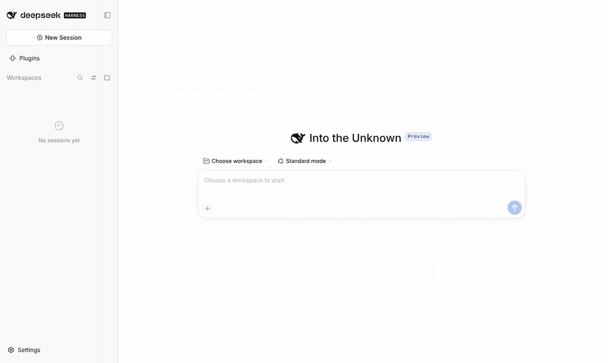
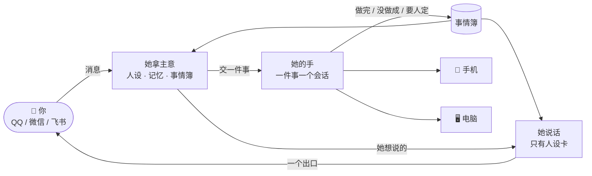

<div align="center">

# ◎ dsh-dot

**让你的 [DeepSeek Harness](https://github.com/deepseek-ai/deepseek-harness) 成为 dot · 一个有人设、有记忆、自己过日子的角色**

装上之后，和你说话的不再是一个 agent，是她。<br>
她记得你，你们不聊天的时候也在过日子，还有自己的手机和电脑。

[](https://www.npmjs.com/package/dsh-dot-life)
[](LICENSE)
[](https://github.com/deepseek-ai/deepseek-harness)
[](package.json)
[](https://github.com/Kevinwu901113/dsh-dot/stargazers)

[](https://dsh.market/)
[](https://awesome-dsh-plugin.com)

**简体中文** · [English](README.en.md)

[她不一样在哪](#-她不一样在哪) · [她有什么](#-她有什么) · [快速开始](#-快速开始) · [常见问题](#-常见问题) · [怎么运作](#-怎么运作) · [用法手册](docs/USAGE.md) · [设置](docs/SETTINGS.md)



</div>

> [!TIP]
> 最快的装法：在 dsh 的「设置 → 插件市场」里搜 `dsh-dot` 点安装，重启后点左侧栏的 **「dot 设置」** 一步步走完。其他装法见[快速开始](#-快速开始)。

---

## ✨ 她不一样在哪

<table>
<tr>
<td width="50%" valign="top">

### 🎭 说话像她
替她说话的那一步只读她的人设卡和你们最近的对话，不带任何工具，也不带 dsh 自己的 agent 提示词。人设卡是一个 Markdown 文件，可以从社区预设导入，也可以自己写，改完她就照新的说。

</td>
<td width="50%" valign="top">

### 📒 事情有下文
你让她去做的每件事都记进一本账：在做、排着、做完、卡住、没做成、被谁叫停、花了多少。她跟你说进度只照账上说，没做成就说没做成，不会编。

</td>
</tr>
<tr>
<td valign="top">

### 🛠️ 手机电脑越用越会
每个 App、手机本身、电脑各有一本「手艺簿」：踩过的坑记成教训，走通的路记成捷径，并数清这条路走成过几次。同一件事下次更快、更准、更省。

</td>
<td valign="top">

### 🔒 不瞒着你动
钱的事不碰；付款、验证码、扫码、人脸这类只有你能做的，她停下来找你；装 App、打电话、删东西、注册这类，先在聊天里问你，你同意了才做。哪一步算哪一档由代码看屏幕决定，不听她自己怎么说。没有要你点的按钮。

</td>
</tr>
<tr>
<td colspan="2" valign="top">

### 🌙 不聊天的时候也在过日子
她有作息：过了点、安静一阵就睡着，睡着后写当天的日记、整理记着你的事；你的消息能叫醒她，别的事等她醒了再看。每天有两段「自己的时间」，不派任务，有一个只属于她的文件夹。她记得你说过的话、你身边的人，也记得她自己遇到的人。

</td>
</tr>
</table>

## 🧰 她有什么

<table>
<tr>
<td width="33%" valign="top">

### 📱 一部手机
插件自己下载、建好一台 Android 模拟器，不需要 Java 或 Android Studio，画面在 dsh 里看。App 她自己装（装之前问你），登录态一直保留。有人发消息来会叫醒她；App 自己的推送不叫醒，攒着等她下次醒来一起看。

</td>
<td width="33%" valign="top">

### 🖥️ 一台电脑
一台自带的小虚拟机（不需要 Docker）：命令行、浏览器、桌面、实时画面。她的命令都在虚拟机里跑，碰不到你的机器。定时任务有结果就推到你的 IM，没有就安静。

</td>
<td width="33%" valign="top">

### 💬 一个 QQ 号
QQ 跑在她的电脑里，和手机上是同一个号。你发消息 1–2 秒叫醒她，她分条回你，会发表情包，会存别人发的图。群里什么时候叫醒她可以选。

</td>
</tr>
</table>

手机和电脑各有电源开关（`/phone off`、`/computer off`，或 dot 设置页顶部），关了重启 dsh 也保持关着。

## 🚀 快速开始

### 你要哪种用法？

| 你想要 | 怎么做 |
|---|---|
| **完整的她**：人设、记忆、手机、电脑、QQ | 照下面装，然后在「dot 设置」里一步步点完 |
| **只要一部手机和一台电脑**，不要角色 | 装好后在插件页关掉 dot / memory / interlude / qq 四个组件，工具还是 `mcp__dot-phone__*` / `mcp__dot-vm__*` |
| **已经在用 [qq-bridge](https://github.com/Derpyu520/qq-bridge)** | 直接装，不用配，插件会自动和它分开，见 [docs/qq-bridge.md](docs/qq-bridge.md) |

### 安装

需要 dsh ≥ 0.2.1，以及硬件虚拟化（Apple silicon / Intel Mac；Linux 需 KVM；Windows 需 WHPX）。

**从 [DSH Market](https://dsh.market/) 装（推荐）**：装好插件市场后，在「设置 → 插件市场」里搜 `dsh-dot` 点安装。

```bash
dsh plugin --profile web add dshmarket
```

**用命令行装**：先退出 dsh 桌面版。

<details open>
<summary><b>macOS</b></summary>

```bash
"/Applications/DeepSeek Harness.app/Contents/Resources/runtime/cli/bin/dsh" plugin --profile desktop add \
  dsh-dot-life @xmanrui/dsh-im
open -a "DeepSeek Harness"
```
</details>

<details>
<summary><b>Windows（PowerShell）</b></summary>

```powershell
& "$env:LOCALAPPDATA\Programs\DeepSeek Harness\resources\runtime\cli\bin\dsh.cmd" plugin --profile desktop add `
  dsh-dot-life @xmanrui/dsh-im
```
</details>

<details>
<summary><b>Web 版 / 从源码</b></summary>

```bash
dsh plugin --profile web add dsh-dot-life
dsh plugin --profile desktop add github:Kevinwu901113/dsh-dot   # 源码
```
</details>

### 第一次设置

重新打开 dsh，点左侧栏的 **「dot 设置」**，照着一步步点完：检查这台电脑 → 选组件 → 手机 → 电脑 → 人设 → QQ。设置、体检（能修的一键修）、导出诊断包也都在这一页。

<details>
<summary><b>每一步具体做什么</b></summary>

1. **人设**：她读的是 `~/dot/persona.md` 这张人设卡。可以 `/interlude preset <分享码>` 从 [typ0.space](https://typ0.space) 导入一份社区预设生成它，也可以直接写。卡按 `## ` 标题分段，哪段给谁读写在 `~/dot/persona/parts.json`。
2. **手机**：接受 Android SDK 许可后，插件下载模拟器和系统镜像（约 2 GB，常见 10–30 分钟），装完自动开机。装的时候照常聊天，她不会等。存储大小只能在建好之前设。
3. **装 App、登录**：在手机画面里像真手机一样操作，或者让她自己装。登录她按自己的账号本来；验证码、扫码、人脸要你本人，她会停下来找你。
4. **QQ**：她用手机摄像头扫码登录电脑上的 QQ，详见 [docs/qq.md](docs/qq.md)。不想用 QQ，也可以按 dsh-im 的说明接微信、飞书或官方机器人。
5. **电脑**：默认装上并启动；不要就设 `DSH_DOT_COMPUTER=off`。在外面用手机看实时画面见 [docs/computer.md](docs/computer.md)。

喜欢敲命令的话，等价的是：

```text
/interlude preset 6QA0-1PD6 # 导入一份人设，换成你喜欢的分享码
/phone doctor               # 体检：虚拟化、磁盘、内存、端口、下载源；能一键修的给 /phone doctor fix <id>
/phone accept               # 接受 Android SDK 许可，手机开始自己装（/phone accept 32 给 32 GB 存储）
/qq install → /qq account <小号> → /qq start → /qq qr
```

</details>

所有个人设置都在一个文件 `~/.dsh/dsh-dot.json`，「dot 设置」页改的就是它，升级插件不会覆盖。每一项的说明在 [docs/SETTINGS.md](docs/SETTINGS.md)。懒得自己改，也可以直接对 dsh 说「按 docs/SETTINGS.md 把 dsh-dot 的手机存储改成 32 GB」。

## ❓ 常见问题

<details>
<summary><b>我的电脑跑得动吗？</b></summary>

需要能开硬件虚拟化。手机默认 3 GB 内存、16 GB 存储（第一次下载约 2 GB）；电脑虚拟机内存上限 4 GB、空闲时约 0.5 GB，磁盘约 10 GB。两样都开，大约留出 8 GB 内存和 30 GB 磁盘。只用其中一样，就把另一样关掉。

</details>

<details>
<summary><b>会被封号吗？</b></summary>

有可能。各平台的条款都不允许自动化操作，**请给她用小号**，QQ 也一样。

</details>

<details>
<summary><b>她会不会乱动我的东西？</b></summary>

她的命令在她自己的虚拟机和模拟器里跑，碰不到你的电脑，你共享给她的文件夹除外。在她自己的设备上，有后果的事分四档：钱的事不做；只有你能做的（付款、验证码、扫码、人脸）停下来找你；装 App、打电话、发短信、删东西、注册、给不熟的人发消息、在电脑上往外连或改你共享的文件，先在聊天里问你；其余是她自己的事。你说「好」只管这一件，说「以后都行」才一直有效。她做过的每一步都有审计记录。

</details>

<details>
<summary><b>她会不会一直烧 token？</b></summary>

她每天的花费在右侧栏的 dot 面板里能看到。一件事花超上限（默认 60 万 token）会停下来问你要不要继续；「自己的时间」每次、每天都有上限；同一个错一直出，代码会把那件事停下。这些上限都在 [docs/SETTINGS.md](docs/SETTINGS.md) 里能改。

</details>

<details>
<summary><b>聊天时报 429 怎么办？</b></summary>

她在后台发的模型请求（整理记忆、操作手机电脑）会排在你的对话后面，不抢你的额度。还是报 429，就调小 `llm.backgroundRpm`。

</details>

<details>
<summary><b>怎么改她说的话、她的提示词？</b></summary>

人设直接改 `~/dot/persona.md`。插件给她的每段提示词也都能改：在 dsh 里发 `/dot prompts`，打开回来的本机网址就能编辑，保存到 `~/dot/prompts/`，覆盖内置版本。

</details>

## 🧩 怎么运作

dsh 负责跑对话、调工具、接 IM；dsh-dot 决定**这段对话里的人是谁**。在她的会话里，dsh 自带的 agent 开场白被换成她的人设、记忆和刚过完的日子；别的工作区里 dsh 还是原来的 dsh。



- **拿主意**：她的对话，读人设、记忆和事情簿，决定做什么、说什么。
- **动手**：每件事交给一个单独的会话，只管操作手机和电脑，不带人设。做完、没做成、或停在要人定的地方，才把结果交回来。
- **说话**：一次单独的调用，只带她的人设卡，写出要发给你的话，从唯一的出口发出去。

插件里有七个组件（人设和自己的时间、记忆、联系人层、手机、电脑、QQ、和其他插件共处），每个都能单独关。完整说明见 [docs/USAGE.md](docs/USAGE.md)。

## 💡 设计原则

- **她是主体**：先有人设、记忆和日子，再有设备。能干活是附带的。
- **能由代码判断的，不交给模型**：哪一步要问你、一件事成没成、同一个错出了几次，都是代码数、代码判。
- **一件事只有一个说法**：结果只从事情簿来，她和替她说话的那一步都不另编。
- **不替她做她该自己做的事**：App 她自己装，日子她自己过。
- **最好的代码是不写代码**：手机用 Google 官方模拟器 + mobile-mcp，电脑用 microsandbox，IM 用 dsh-im，定时用 dsh 自带的。
- **可审计**：每一次工具调用、每一笔花费都有记录。

## 🙏 致谢

[HDS-Interlude](https://github.com/REcklessNOLOve117/HDS-Interlude) · [mobile-mcp](https://github.com/mobile-next/mobile-mcp) · [microsandbox](https://github.com/zerocore-ai/microsandbox) · [NapCatQQ](https://github.com/NapNeko/NapCatQQ) · [SnowLuma](https://github.com/SnowLuma/SnowLuma) · [dsh-im](https://github.com/xmanrui/dsh-im) · [Moltbook](https://www.moltbook.com/heartbeat.md) · [chat-memory-benchmark](https://github.com/Ornn8/chat-memory-benchmark)

## 📄 许可证

[MIT](LICENSE)。0.3 到 0.22 的版本以 AGPL-3.0-only 发布（当时幕间用了 HDS-Interlude 的提示词译文），那些版本仍按 AGPL；0.23 起幕间提示词全部重写，不含 HDS-Interlude 的代码或文字，整包按 MIT 发布。

<div align="center">

---

如果她让你会心一笑，点个 ⭐ 吧

[](https://star-history.com/#Kevinwu901113/dsh-dot&Date)

</div>
