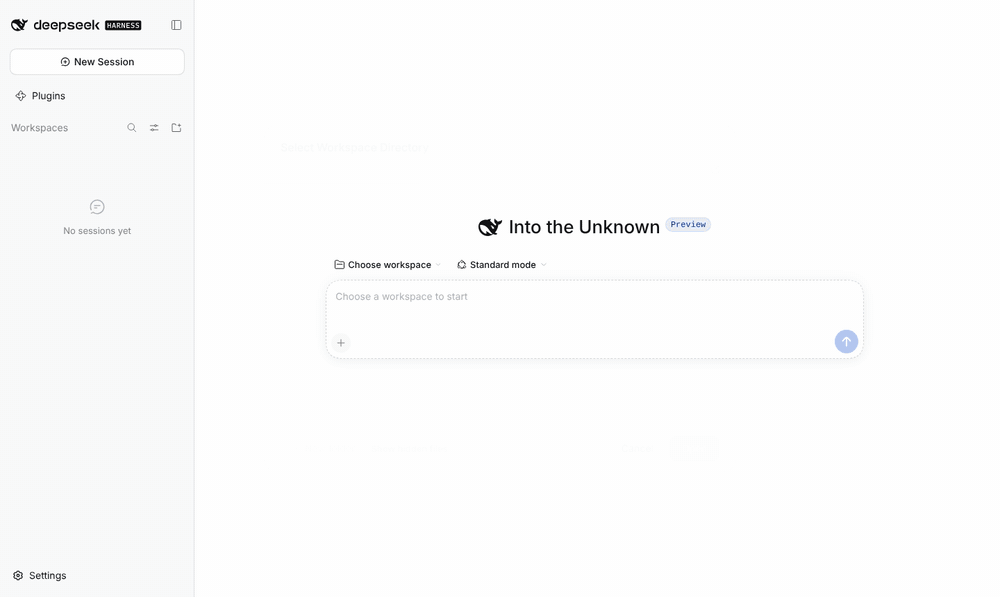
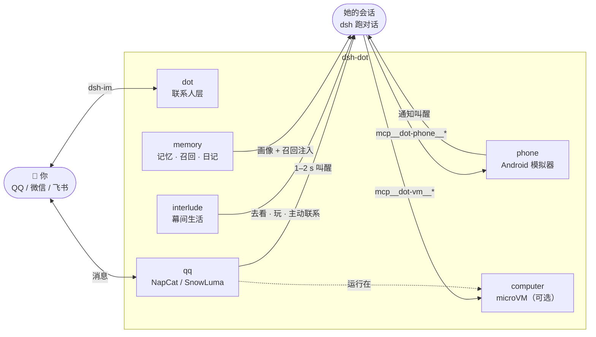

<div align="center">

# ◎ dsh-dot

**一个在自己手机上过日子的角色 · 给 [DeepSeek Harness](https://github.com/deepseek-ai/deepseek-harness) 的养鱼插件**

她有自己的安卓手机、自己的 QQ、自己的作息和日记。<br>
你们不聊天的时候，她也在过日子。

[](https://www.npmjs.com/package/dsh-dot-life)
[](LICENSE)
[](https://github.com/deepseek-ai/deepseek-harness)
[](package.json)
[](https://github.com/Kevinwu901113/dsh-dot/stargazers)

**简体中文** · [English](README.en.md)

[快速开始](#-快速开始) · [她能做什么](#-她能做什么) · [设置](#%EF%B8%8F-设置) · [架构](#-架构) · [命令](#%EF%B8%8F-命令与文件) · [共存](#-与其他插件共存) · [路线图](docs/ROADMAP.md)



</div>

---

## ✨ 她能做什么

<table>
<tr>
<td width="50%" valign="top">

### 📱 有一部真的手机
插件自己下载、建好、开机一台 Android 模拟器，不需要 Java / Android Studio。App 和登录态都在里面，重启不丢。手机没带应用商店，**App 让她自己去装**。

</td>
<td width="50%" valign="top">

### 💬 有自己的 QQ
NapCat / SnowLuma（OneBot 11）和她手机上同一个账号。你发消息 **1–2 秒叫醒她**，她分条回、会发表情包、会存别人发的图。

</td>
</tr>
<tr>
<td valign="top">

### 🌙 两次对话之间也在生活
「幕间」移植自 [HDS-Interlude](https://github.com/REcklessNOLOve117/HDS-Interlude)：写下这段时间的日子、记下打算、拿手机去看她好奇的东西，偶尔有真实的理由来找你。

</td>
<td valign="top">

### 🧠 记得你，也记得她遇到的人
画像 + 碎片 + 交班，每个人一张卡；0.12 起叫醒前自动召回最相关的旧对话。公开记忆基准 **74 → 95 / 108**。每天 23:30 写日记。

</td>
</tr>
<tr>
<td valign="top">

### 🎮 自己逛、自己玩
小黑盒、B 站、微博、小红书……她装了哪个就逛哪个，点赞、评论、关注。玩多少不设配额，由她自己养成的习惯决定。

</td>
<td valign="top">

### 🖥️ 想让她干活？给她一台电脑
可选的 microVM（不需要 Docker）：shell、浏览器、桌面、实时画面、审批闸门、审计日志。定时任务有结果推到 IM，没有就安静。

</td>
</tr>
</table>

> [!NOTE]
> **她只能看，不能瞒着你动。** 「去看」是只读的；装 App、输密码、付款、给陌生人发消息这类有后果的动作，要么走审批，要么根本不给。

## 🚀 快速开始

需要 dsh ≥ 0.2.1，以及硬件虚拟化（Apple silicon / Intel Mac；Linux 需 KVM；Windows 需 WHPX）。先退出 dsh 桌面版：

<details open>
<summary><b>macOS</b></summary>

```bash
"/Applications/DeepSeek Harness.app/Contents/Resources/runtime/cli/bin/dsh" plugin --profile desktop add \
  dsh-dot-life @xmanrui/dsh-im
open -a "DeepSeek Harness"
```
</details>

<details>
<summary><b>Windows（PowerShell）</b></summary>

```powershell
& "$env:LOCALAPPDATA\Programs\DeepSeek Harness\resources\runtime\cli\bin\dsh.cmd" plugin --profile desktop add `
  dsh-dot-life @xmanrui/dsh-im
```
</details>

<details>
<summary><b>Web 版 / 从源码</b></summary>

```bash
dsh plugin --profile web add dsh-dot-life
dsh plugin --profile desktop add github:Kevinwu901113/dsh-dot   # 源码
```
</details>

然后在 dsh 里：

```text
/phone accept               # 接受 Android SDK 许可，手机开始自己装（约 2 GB；/phone accept 32 给 32 GB 存储）
/interlude preset 6QA0-1PD6 # 从 typ0.space 导入一份 HDSI 人设，换成你喜欢的分享码
/qq install → /qq account <小号> → /qq start → /qq qr   # 她用手机摄像头扫码登录电脑 QQ
```

<details>
<summary><b>第一次设置的完整说明</b></summary>

1. **手机**：`/phone accept` 后插件下载模拟器、platform-tools、系统镜像（进度在 `~/.dsh/dsh-phone.log`），装完自动开机，桌面出现手机窗口。存储大小建好后不能再改。`/phone` 看状态。
2. **装 App、登录**：在手机窗口里像真手机一样操作，或者让她自己装（`mobile_install_app` 会弹审批）。登录、验证码、人脸由你亲手过，她遇到会停下来叫你。**用小号**，各平台条款都不允许自动化。
3. **人设**：`/interlude preset <分享码>`，或把 [`examples/canon.minase-style.json`](examples/canon.minase-style.json) 放到 `~/dot/interlude/canon.json`。
4. **她逛什么**：不用配。常见社区 App 的站点 → 包名表是内置的，只对她**自己装了**的 App 生效。其他 App 在 `cordis.patch.yml` 里给 `dot-interlude` 加 `phoneApps` / `playApps`。
5. **QQ**：详见 [docs/qq.md](docs/qq.md)。不想用协议端，也可以按 dsh-im 的说明接官方机器人。
6. **电脑（可选）**：默认装上并启动；不要就设 `DSH_DOT_COMPUTER=off`。公网看实时画面见 [docs/computer.md](docs/computer.md)。

</details>

## ⚙️ 设置

所有个人设置都在**一个文件**：`~/.dsh/dsh-dot.json`（Windows：`%USERPROFILE%\.dsh\dsh-dot.json`），按组件分段，升级插件不会覆盖，改完重启 dsh。

```json
{
  "phone":     { "dataGb": 32 },
  "computer":  { "rootDisk": "32G", "memory": "6G" },
  "interlude": { "activeHours": "09:00-01:00", "speak": true }
}
```

存储、作息、主动联系、群聊规则、省 token、网络镜像……每一项怎么改、哪些只在新建手机 / 虚拟机时生效，都在 **[docs/SETTINGS.md](docs/SETTINGS.md)**。

> [!TIP]
> 懒得自己改？直接对 dsh 说「按 docs/SETTINGS.md 把 dsh-dot 的手机存储改成 32 GB」。文档里有写给 agent 的规则，dsh 或其他 agent 照着就能改对。

## 🧩 架构

一个插件，六个组件。每个都能单独关，缺了哪个其余照常跑。



| 组件 | 是什么 | 依赖 | 关掉 |
|---|---|---|---|
| **`phone`** 📱 | Android 模拟器，以 `mcp__dot-phone__*` 暴露（[mobile-mcp](https://github.com/mobile-next/mobile-mcp) 走 adb）；任何 App 的通知都能叫醒她 · [文档](docs/phone.md) | 硬件虚拟化 | `DSH_DOT_PHONE=off` |
| **`interlude`** 🌙 | 幕间：Canon 人设、剧本、连续性、打算、只读的「去看」、可选的主动联系 · [文档](docs/interlude.md) | — | `DSH_DOT_INTERLUDE=off` |
| **`qq`** 💬 | 她电脑 VM 里的 QQ，和手机同号；`qq_send` 回复、表情包 · [文档](docs/qq.md) | computer | `DSH_DOT_QQ=off` |
| **`memory`** 🧠 | 画像、人物卡、碎片、日记；15 万 token 交班；自动召回（默认本机 bge-small-zh，可切 SiliconFlow / DashScope） · [文档](docs/memory.md) | — | `DSH_DOT_MEMORY=off` |
| **`dot`** ◎ | 定时结果 → IM、审批与设备提醒、工作规则、右侧栏状态面板 | [dsh-im](https://github.com/xmanrui/dsh-im) | `DSH_DOT_CONTACT=off` |
| **`computer`** 🖥️ | 自带 microVM：shell、浏览器、桌面、实时画面、审批、审计 · [文档](docs/computer.md) | [microsandbox](https://github.com/zerocore-ai/microsandbox)（自带）或 Docker | `DSH_DOT_COMPUTER=off` |

## 🕰️ 她的一天

| 时刻 | 发生什么 |
|---|---|
| **你找她** | QQ 消息 1–2 秒叫醒她的对话；她忙时来的消息攒到那轮结束一起处理，回复按行拆成多条 |
| **手机响了** | 任何 App 的新通知叫醒她：`[手机通知] QQ · 宽：在吗`。她自己去回，或者不理 |
| **拿起手机** | 没响也会隔一阵（默认 30 分钟）看一眼，有没回的就回，没事就放下 |
| **安静下来** | 跑一轮**幕间**：写下这段日子、更新打算、想去看点什么 |
| **去看 · 玩** | 在独立的「跑腿」会话里用手机看、点赞、评论；截图不进你们的对话，只留一句「刚才拿起手机看了一眼」 |
| **想找你** | 过了活跃时段、意愿值、每日上限、投递目标四道闸，才发消息给你 |
| **23:30** | 写今天的日记 |

## ⌨️ 命令与文件

```text
/phone [accept|restart|screenshot]
/interlude [now|advance|seed|preset <code>|canon]
/dot [test|check]
/dot memory [now|diary|handoff|recall …]
/dot people [approve <id>|drop <id>|forget <名字>]
/qq [install|account|start|qr|backend|owner]
```

**改提示词**：她收到的每段话都是 `src/prompts/` 里的纯文本，复制到 `~/dot/prompts/` 改就能覆盖；`npm run prompts` 打开本机页面直接改，见 [docs/prompts.md](docs/prompts.md)。

**状态面板**：会话顶部 ◎ 按钮打开右侧栏 dot 标签页——设备状态、交班进度、她此刻在做什么、今天的 token，以及**最近 30 场**（每次被叫醒到结束是一场，展开看她做了什么、说了什么）。

<details>
<summary><b>数据都在哪</b></summary>

| 路径 | 内容 |
|---|---|
| `~/dot/interlude/` | 人设 `canon.json`、剧本 `script.md`、连续性 `state.json`、打算 `intents.json`、看到的东西、每轮原始回复与 token |
| `~/dot/memory/` | `memory.md`（给你看的）、`diary.md`、`transcript.jsonl`、召回索引 `recall/`、交班记录 |
| `~/.dsh/phone/` | 模拟器、镜像、AVD；`~/.dsh/dsh-phone*.{log,jsonl,json}` 日志 / 审计 / 设置 |
| `~/.dsh/dsh-computer*` | 电脑的日志、审计、状态 |

</details>

<details>
<summary><b>安全边界</b></summary>

- 手机实时画面、dot 面板、电脑实时桌面都挂在 dsh 自己的 web server 上（`/dsh-dot/*`），每个请求先过 dsh 的 `connection` 服务（登录态 + Host/Origin 围栏）。插件不开自己的端口、不自带鉴权。
- 虚拟机网关只绑 `127.0.0.1:18080`，要求密钥（每台机器自动生成在 `~/.dsh/dsh-computer.key`），只有插件内部持有。
- **「你」只有一个来源**：`/qq owner` 指定的号。手机通知上的昵称谁都能改，永远不算你的指令。
- 她看到什么、为什么没出声、哪次工具被拒，`calls.jsonl` 和审计日志里都有。

</details>

## 🤝 与其他插件共存

<details>
<summary><b>装别的插件前先看一眼</b></summary>

- **电脑组件开着时会改全局设置**：subprocess provider 换成虚拟机里的、`sandbox-policy` 设为 `danger-full-access`（虚拟机才是隔离边界）、权限预设改写成 `computer` / `computer-auto`。所以不要同时装别的沙箱 / subprocess / 权限预设插件；要用就 `DSH_DOT_COMPUTER=off`。
- **MCP 工具名有命名空间**：`mcp__dot-vm__*`、`mcp__dot-phone__*`，前缀定义在 `src/tool-prefixes.js`。
- **记忆共存**：`DSH_DOT_MEMORY_COEXIST` 默认 `auto`，发现 `hermesMemory` / `autoMemory` / `dshMemory` / `memoryBank` 等就切到 `people-only`，只保留人物卡、碎片、日记，免得两个插件一起"讲记忆"。`full` / `people-only` 可强制。
- **一个 QQ 号只能有一个应答者**：不要在她的号上再跑别的 OneBot 机器人。
- **`bash` 也过电脑闸门**：别的插件再给 `bash` 加审批，同一条命令会弹两次。
- **上下文压缩插件**：dsh-dot 注入的消息带固定 `source`，压缩时请保留、别当成用户原话：

  | source | 含义 |
  |---|---|
  | `{ kind: 'dsh-dot', form: 'phone-notification' }` | 手机通知叫醒 |
  | `{ kind: 'dsh-dot', form: 'phone-check' }` | 定时看手机 |
  | `{ kind: 'dsh-dot', form: 'errand-note' }` | 跑腿结果回写 |
  | `{ kind: 'dsh-interlude', form: 'observation' \| 'play' }` | 幕间观察 / 玩 |
  | `{ kind: 'handoff', generation }` | 记忆交班 |
  | `{ kind: 'user', rpcId: 'qq-…' }` | 主人的 QQ 消息（普通用户消息） |

</details>

<details>
<summary><b>从旧版本升级</b></summary>

- **v0.9 起 npm 包名是 `dsh-dot-life`**（`dsh-dot` 在 npm 上被占；v0.8.x 的 `@kevinwu901113/dsh-dot` 已 deprecated）。装过旧名的先 `dsh plugin --profile desktop remove @kevinwu901113/dsh-dot` 再装，`~/dot`、`~/.dsh/phone`、虚拟机都不用动。
- **v0.9.2 起工具名带命名空间**：`mcp__vm__*` → `mcp__dot-vm__*`，`mcp__phone__*` → `mcp__dot-phone__*`。
- `dsh-computer`（v0.1–0.5）和 `dsh-interlude` 曾是独立插件，v0.3 / v0.4 起并入，git 历史一并合入。装过的先 `remove dsh-computer dsh-interlude`。

</details>

## 💡 设计原则

- **最好的代码是不写代码**：手机用 Google 官方模拟器 + mobile-mcp，电脑用 microsandbox，IM 用 dsh-im，定时用 dsh 内置的，人设用 HDSI 社区预设。
- **不替她做她该自己做的事**：App 她自己装，日常她自己过。
- **她只能看，不能瞒着你动**：有后果的动作走审批，或者根本不给。
- **可审计**：每一轮的原始回复、每一次工具调用都有记录。
- **用小号**。

## 🙏 致谢

[HDS-Interlude](https://github.com/REcklessNOLOve117/HDS-Interlude) · [mobile-mcp](https://github.com/mobile-next/mobile-mcp) · [microsandbox](https://github.com/zerocore-ai/microsandbox) · [NapCatQQ](https://github.com/NapNeko/NapCatQQ) · [SnowLuma](https://github.com/SnowLuma/SnowLuma) · [dsh-im](https://github.com/xmanrui/dsh-im) · [Moltbook](https://www.moltbook.com/heartbeat.md) · [memory-system-benchmark](https://github.com/Ornn8/memory-system-benchmark)

## 📄 许可证

[AGPL-3.0-only](LICENSE)。幕间组件按原文使用 HDS-Interlude（AGPL-3.0）的提示词，所以整个包按 AGPL 发布；v0.3 之前以 MIT 发布的 computer / dot 代码，那些版本仍按 MIT 可用。

<div align="center">

---

如果她让你会心一笑，点个 ⭐ 吧

[](https://star-history.com/#Kevinwu901113/dsh-dot&Date)

</div>
